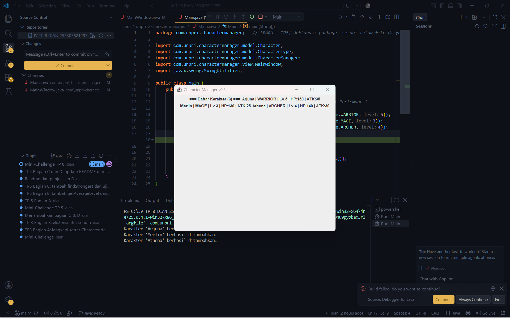
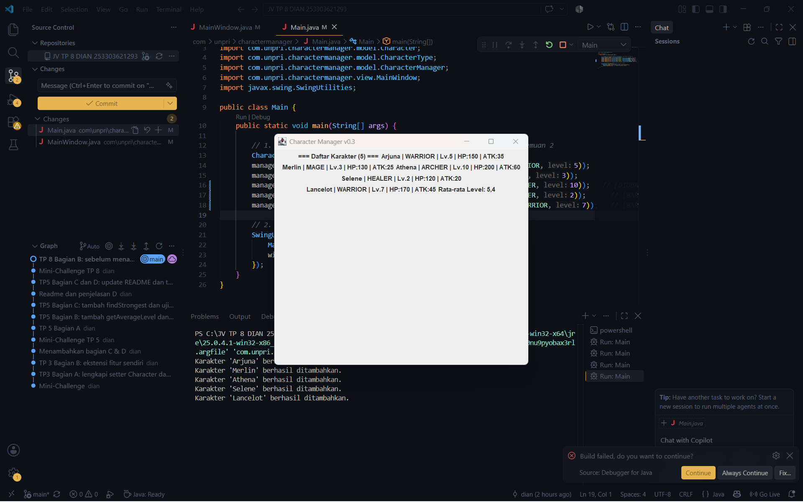

# TP8 - Character Manager GUI (MainWindow)

## Tampilan MainWindow
Screenshot sebelum data diubah (5 karakter, Rata-rata Level 4.2):

Screenshot sesudah level Athena diubah dari 4 menjadi 10 (Rata-rata Level menjadi 5.4):

## Aliran data Main - CharacterManager - MainWindow
Main.java membuat object CharacterManager lalu mengisinya dengan lima karakter lewat addCharacter(). Setelah data siap, Main memanggil getAllCharacters() yang mengembalikan salinan list, lalu salinan itu dikirim ke constructor MainWindow. MainWindow menyimpan list tersebut, membuat satu JLabel untuk setiap karakter lewat perulangan, dan menghitung rata-rata level dari list yang sama. Pembagian ini mengikuti MVC: CharacterManager dan Character berada di package model sebagai pemegang data, MainWindow berada di package view yang hanya menampilkan data, dan Main menjadi titik awal yang menyiapkan data lalu menyerahkannya ke tampilan.

## Karakter baru
| Nama     | Tipe    | Level | Alasan |
| Lancelot | WARRIOR | 7     | Level tertinggi di daftar, supaya perubahan nilai     rata-rata terlihat jelas dan HP serta ATK-nya paling besar. |
| Selene   | HEALER  | 2     | Level terendah, dan tipe HEALER belum ada di tiga karakter awal sehingga keempat tipe CharacterType muncul di jendela. |

## Bagian D
Google Docs: [Klik di sini](https://docs.google.com/document/d/12CECCE-cpFjhxU-xszsHt2uGDzFAkJPADSn0Kh9VaUY/edit?usp=sharing)