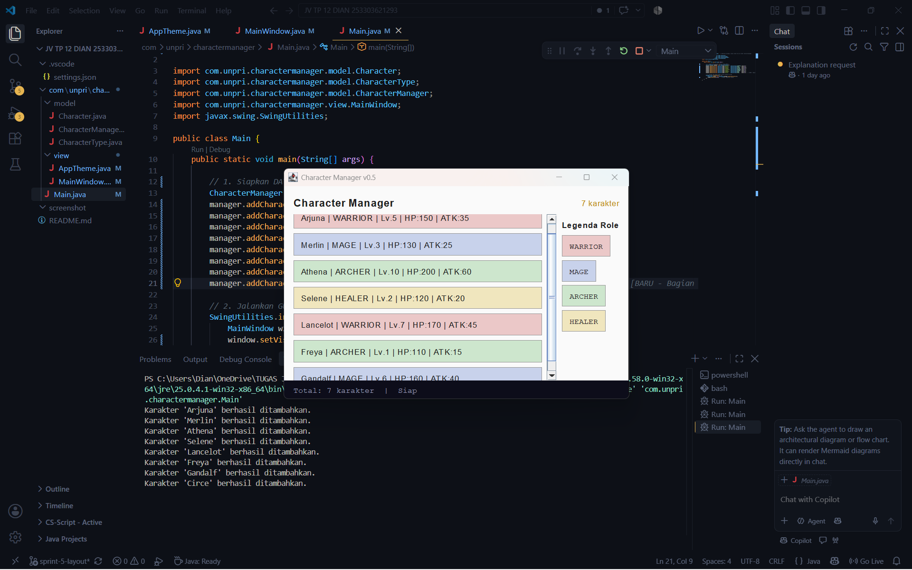
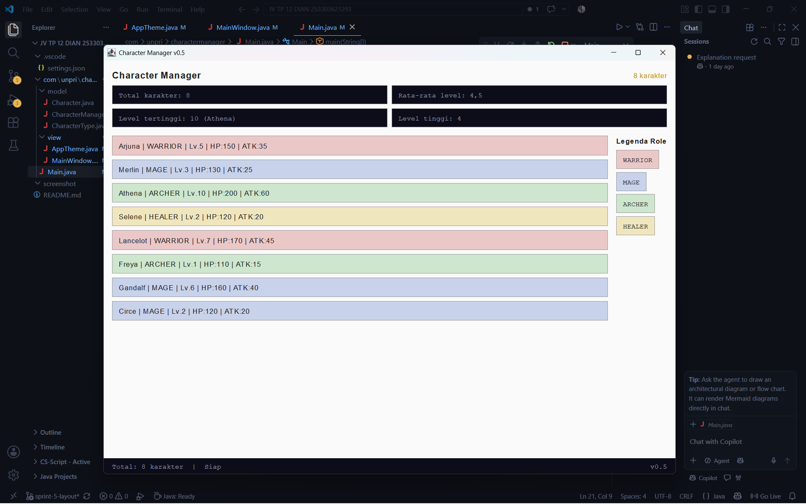
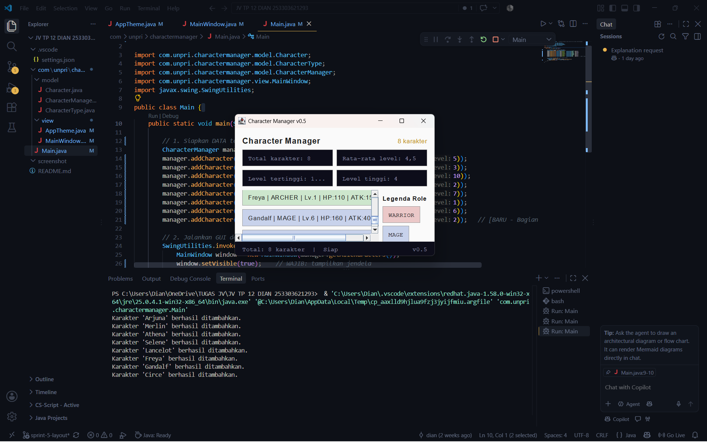

## TP12 - Sprint #5: Layout MainWindow v0.5

## Tampilan
Ukuran awal:

Jendela dilebarkan:

Jendela dikecilkan sampai scrollbar tampak:

## Bagian A - Struktur layout
MainWindow v0.5 memakai BorderLayout dengan empat wilayah terisi: header di NORTH, daftar karakter berscroll di CENTER, legenda role di EAST, dan bar status di SOUTH. Daftar karakter berada dalam JScrollPane, kartu ditambahkan ke panel (bukan ke scroll pane), dan scroll.setPreferredSize terpasang agar jendela tidak membengkak saat data banyak. Legenda memakai BoxLayout Y_AXIS yang target container-nya adalah panel legenda sendiri, dengan strut sebagai spasi tetap dan glue untuk mendorong chip ke atas, dan chip dibuat dari CharacterType.values() sehingga otomatis ikut bertambah jika role baru ditambahkan. Tidak ada setLayout(null) dan tidak ada nilai warna atau font yang ditulis langsung di MainWindow, karena semuanya diambil dari AppTheme. Package model tidak berubah dibandingkan Sprint #4, dibuktikan dengan git diff yang kosong.

## Bagian B - Mini-Challenge
Bar status di SOUTH memakai BorderLayout: teks status di WEST dan label versi "v0.5" di EAST. Layout ini dipilih karena kebutuhannya dua kutub kiri dan kanan, sama seperti header, sehingga teks tetap menempel kiri dan versi tetap menempel kanan berapa pun lebar jendela. Teks versi disimpan di satu konstanta VERSI yang dipakai untuk judul jendela dan label di bar status, jadi angka versi tidak tertulis di dua tempat.

## Bagian B - Panel baru: statistik GridLayout 2x2
Panel statistik berisi empat sel: total karakter, rata-rata level, level tertinggi beserta namanya, dan jumlah karakter level tinggi. Panel ini ditaruh di bawah header. Karena wilayah NORTH pada BorderLayout hanya bisa berisi satu komponen, header dan panel statistik dibungkus dalam satu panel yang juga ber-BorderLayout, lalu panel pembungkus itu yang dimasukkan ke NORTH.

Layout yang dipilih adalah GridLayout 2x2 karena keempat statistik setara pentingnya dan perlu berukuran sama, sedangkan GridLayout membagi ruang menjadi sel yang persis sama besar dan tetap rapi saat jendela dilebarkan.

Layout yang saya tolak:
1. FlowLayout, karena lebar tiap sel mengikuti isi teksnya sehingga ukurannya tidak seragam, dan saat jendela menyempit sel-selnya turun ke baris berikutnya dengan susunan yang berubah-ubah.
2. BoxLayout, karena untuk bentuk 2x2 harus dibuat dua baris yang masing-masing ber-BoxLayout dan lebar selnya tidak otomatis sama.
3. Null layout (setLayout(null)), karena setiap posisi harus ditulis dengan koordinat piksel sehingga tidak ikut menyesuaikan saat ukuran jendela berubah.

## Data karakter
Total ada delapan karakter dengan level 5, 3, 10, 2, 7, 1, 6, dan 2, dengan role WARRIOR (2), MAGE (3), ARCHER (2), dan HEALER (1). Rata-rata level 4,5 dan level tertinggi 10 (Athena). Variasi ini membuat scrollbar teruji dan keempat chip role di legenda terlihat.

## Pengamatan saat jendela diubah ukurannya
| Tindakan                 | Hasil                                                                             |
|---                       |---                                                                                |
| Dilebarkan               | Daftar karakter di CENTER dan panel statistik ikut melebar. Legenda tetap selebar semula, dan "v0.5" tetap menempel di kanan bar status.                                                         |
| Ditinggikan              | Daftar bertambah tinggi dan kartu tidak melar.                                    |
| Dikecilkan               | Scrollbar vertikal muncul di area daftar. Saat lebar ikut dikecilkan, scrollbar horizontal juga muncul dan sebagian teks statistik terpotong.                                                  |
| Disempitkan sampai batas | Jendela berhenti mengecil di ukuran minimum 560 x 380 karena setMinimumSize.      |

## Bagian D
Google Docs: [Klik di sini](https://docs.google.com/document/d/1wL43Y6Zo-HH6phTSrSfdW7UCGtMisnC6jIE0fXp3zsc/edit?usp=sharing)