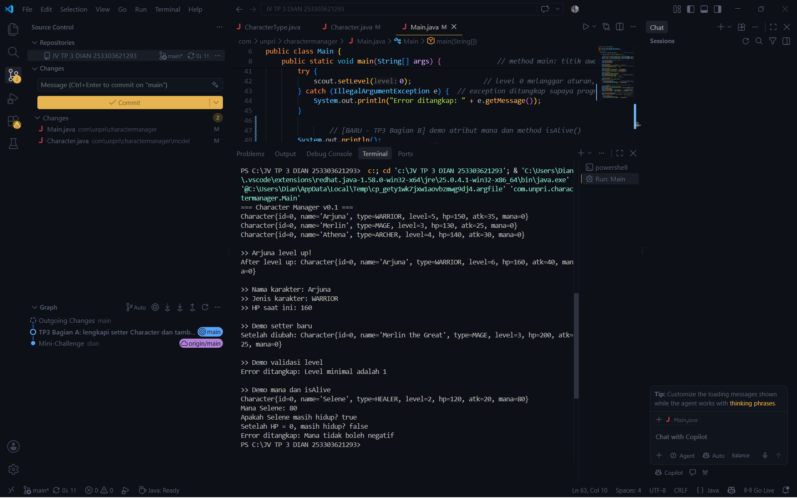

# Character Manager — TP3 (Java Visual SIH-6406)

## Deskripsi

Character Manager adalah aplikasi Java berbasis console yang mengelola data karakter permainan. Setiap karakter memiliki nama, jenis (WARRIOR, MAGE, ARCHER, HEALER), level, hit points, attack power, dan mana. Project ini menerapkan prinsip Encapsulation: semua atribut bersifat private dan diakses melalui getter dan setter yang memiliki validasi. Method `isAlive()` dipakai untuk memeriksa apakah karakter masih hidup (hit points lebih dari 0).

## Screenshot Output


## Struktur Folder

```
JV TP 3 DIAN 253303621293/
├── src/
│   ├── com/
│   │   └── unpri/
│   │       └── charactermanager/
│   │           └── model/
│   │               ├── Character.java
│   │               └── CharacterType.java
│   └── Main.java
├── screenshot/
│   └── output-main-tp3
└── README.md
```

## Identitas Mahasiswa

Nama Lengkap:Dian Enda Hapsari
NIM:253302621293
Google Docs Bagian D: [Klik di sini](https://docs.google.com/document/d/1EnGNuJ_O0jHTm5pgvTzrEUnLDiQgN19IORD_BQLvz6A/edit?tab=t.0)